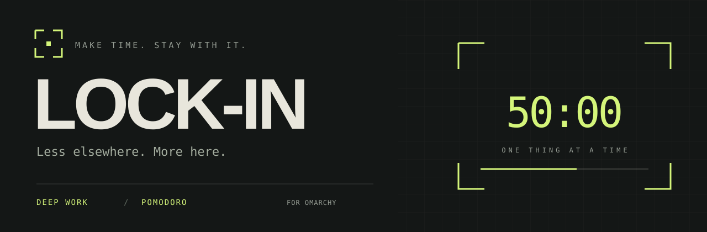

<div align="center">



# Lock-In

**Pick your work. Set your time. Stay with it.**

[](https://omarchy.org)
[](LICENSE)

</div>

## Install

```sh
omarchy plugin add https://github.com/valvesky/lockin.git --enable
```

Requires Omarchy with Quickshell plugin support and Python 3.10+. Click the lock icon in your bar to start.

## About

Lock-In helps you commit to the work you said you would do. Choose your rhythm, set the time, and lock in:

- **Deep Work** — one uninterrupted block.
- **Pomodoro** — automatic focus and break cycles.

The workspace guard brings you back when you wander off during focus. Breaks set you free.

Turn on **Block social media** to keep X, YouTube, Reddit, Pinterest, Instagram, TikTok, Facebook and other feeds out of every browser during focus. It adds a marked section to `/etc/hosts` and removes it on breaks and when the session ends. The first time, Lock-In asks for your password once to install a small helper (`/usr/local/libexec/lockin-sites`) and a sudo rule (`/etc/sudoers.d/lockin-sites`) that allows only `block` and `unblock`. Delete those two files to undo it. No pauses or skips; a deliberate emergency unlock is always available.

Follows your Omarchy theme. Everything stays on your machine.
