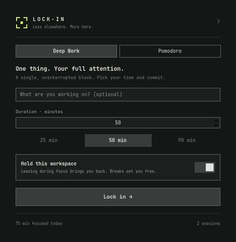
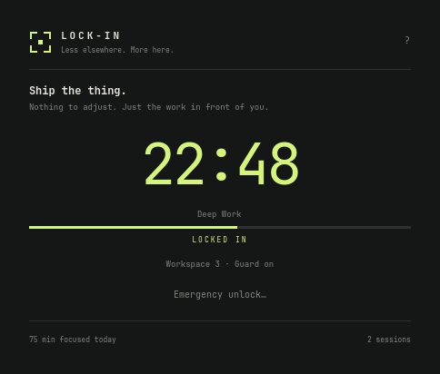
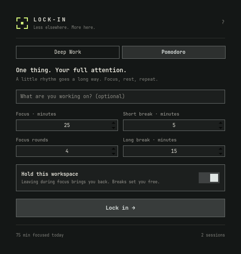
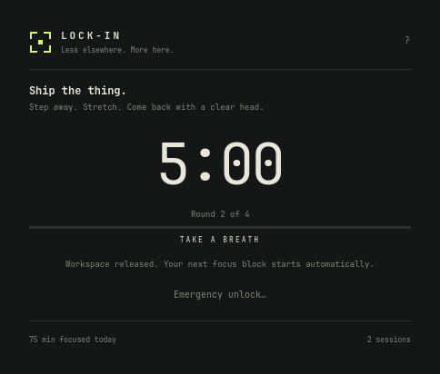

<div align="center">


# Lock-In

**Pick your work. Set your time. Stay with it.**

[](https://github.com/valvesky/lockin/actions/workflows/test.yml)
[](https://omarchy.org)
[](LICENSE)




</div>

Lock-In is a native Omarchy bar plugin for getting through the work you said you would do. Choose **Deep Work** or **Pomodoro**, commit to a session, and let the workspace guard bring you back when you wander off.

No pause button. No shortening the timer halfway through. Just a little friction between you and elsewhere.

## Two ways to lock in

| | Deep Work | Pomodoro |
| --- | --- | --- |
| Rhythm | One uninterrupted block | Focus → break → repeat |
| Default | 50 minutes | 25-minute focus, 5-minute break, 4 rounds |
| Customize | 1–480 minutes; 25 / 50 / 90 presets | Focus, short break, long break, and round count |
| Workspace guard | Active for the whole block | Active during focus; released for breaks |

Pomodoro starts each next block automatically. Every fourth focus round gets a longer break **if another round remains**. The final focus round finishes the session; there is no extra break at the end. The default four-round session lasts 115 minutes, including 100 minutes of focus.

## Install

You need **Omarchy with its Quickshell plugin system**, **Hyprland**, **Python 3.10+**, and `notify-send` for phase notifications. Check that `omarchy plugin --help` is available. There is nothing to compile and no Python dependencies to install.

```sh
omarchy plugin add https://github.com/valvesky/lockin.git --enable
```

Click the lock icon in your bar, enter what you are working on, choose your timing, and press **Lock in**. On a horizontal bar, the icon becomes a live countdown during a session. Vertical bars keep the compact icon; click it for the timer.

Put your work windows on the workspace you want to commit to **before starting**. “Hold this workspace” captures your current regular workspace. Turn it off before starting if you only want the strict timer.

<details>
<summary>Local development install</summary>

```sh
git clone https://github.com/valvesky/lockin.git
cd lockin
bin/test
bin/install
```

The local installer links the checkout into `~/.config/omarchy/plugins/valvesky.lockin` and places the widget in the right bar section. Keep the checkout where it is. Existing installations at another path are left alone.

</details>

## The commitment

- **Your session stays fixed.** The mode, durations, round count, and guard setting cannot change once it starts.
- **Leaving brings you back.** The guard watches Hyprland events and returns focus to your committed workspace. It also closes special workspace overlays during focus blocks and checks once a second as a fallback.
- **Breaks mean breaks.** Move around freely; the next focus block brings you back automatically.
- **Closing the panel changes nothing.** One background service owns the timer for every monitor, including custom Omarchy bars.
- **A shell restart keeps the deadline.** State is saved atomically. Timers use absolute deadlines, so sleep, logout, and time away still count toward the session; missed Pomodoro phases can pass while you are away.
- **There is a way out.** Choose **Emergency unlock**, type `UNLOCK`, and end the session deliberately. It is recorded as interrupted. Completed focus blocks and time before interruption contribute to the daily total; breaks do not.

This is a commitment aid, not a security boundary. Apps and websites on the committed workspace remain usable. You can disable the plugin or stop its service. Lock-In does not kill your apps, edit Hyprland configuration, change your firewall, or require root.

## Fits the desktop

The panel follows Omarchy's theme, fonts, corner radius, motion preferences, and language. English and European Portuguese are included, with English fallback for other languages. All intention text is rendered as plain text.

Focus, break, and completion notifications come through the desktop notification system. The footer shows focus minutes and completed sessions from locally retained history. Everything stays on your machine: no accounts, analytics, or network requests.

<div align="center">


</div>

## Keyboard

| Key | Action |
| --- | --- |
| `Space` | Start a session when the panel itself has focus |
| `Tab` / `Shift+Tab` | Move between controls |
| `Enter` | Activate a focused control or submit the intention |
| `Esc` | Dismiss help or emergency unlock, then close the panel |
| `?` | Show shortcuts when the panel has focus |

You can also open the panel from a terminal or an Omarchy keybinding:

```sh
omarchy-shell lockin toggle
```

## Update or remove

```sh
omarchy plugin update valvesky.lockin
omarchy plugin disable valvesky.lockin
omarchy plugin remove valvesky.lockin
```

Disabling releases the guard by stopping its service. Saved sessions remain, so re-enabling before the deadline resumes the commitment. Removal leaves your local history in place.

Durable state lives at `$XDG_STATE_HOME/lockin/state.json` (normally `~/.local/state/lockin/state.json`). The most recent 200 ended sessions are retained. The control socket and live heartbeat live under `$XDG_RUNTIME_DIR/lockin/`, with access restricted to your user. The heartbeat is written in the runtime directory; durable state is written only on session changes.

## Develop

```sh
bin/test                      # Session, service, IPC, and metadata tests
bin/preview                   # Real QML interaction checks + screenshots, offscreen
python3 tests/live_guard.py    # Explicit live check; briefly switches to an empty workspace
```

`bin/preview` needs Omarchy, Quickshell, and QtTest. It uses the real panel, exercises mouse and keyboard actions, checks markup-shaped intention text, and captures English and Portuguese states in `.cache/previews/`. It does not change your desktop's language or theme.

```text
manifest.json       Omarchy entry points and widget metadata
Service.qml         Single backend process and desktop notifications
SessionClient.qml   Bar-independent local session connection
BarWidget.qml       Bar icon, countdown, and native popup
FocusView.qml       Session setup, timer, and emergency unlock
src/engine.py       Deterministic session model
src/backend.py      Persistence, local IPC, and Hyprland guard
i18n/               English and Portuguese catalogs
tests/              Unit, protocol, QML, and live integration checks
```

After backend changes, disable and re-enable the plugin. If QML changes in a linked checkout are not picked up, run `omarchy restart shell`.

Inspect the service without opening the panel:

```sh
omarchy-shell lockin-session status
```

The backend also accepts JSON over its local socket through `python3 src/backend.py request '{"action":"status"}'`. Supported actions are `status`, `start` with an `options` object, `reset` after a session ends, and `unlock` with `"confirmation":"UNLOCK"`. Errors are returned as JSON codes. The same commitment rules apply to every client.

Tested on Omarchy 4.5.0rc3, Quickshell 0.3.2, and Hyprland 0.56.2. The guard uses Hyprland's Lua dispatch API with a fallback for older configurations. Multi-monitor behavior has unit coverage; live integration was checked on one display.

## Contribute

Small, focused changes are welcome. See [CONTRIBUTING.md](CONTRIBUTING.md) for the checks and conventions. If you find a bug, include your Omarchy, Quickshell, and Hyprland versions and what you expected to happen.

## License

[MIT](LICENSE). Built for [Omarchy](https://omarchy.org).
